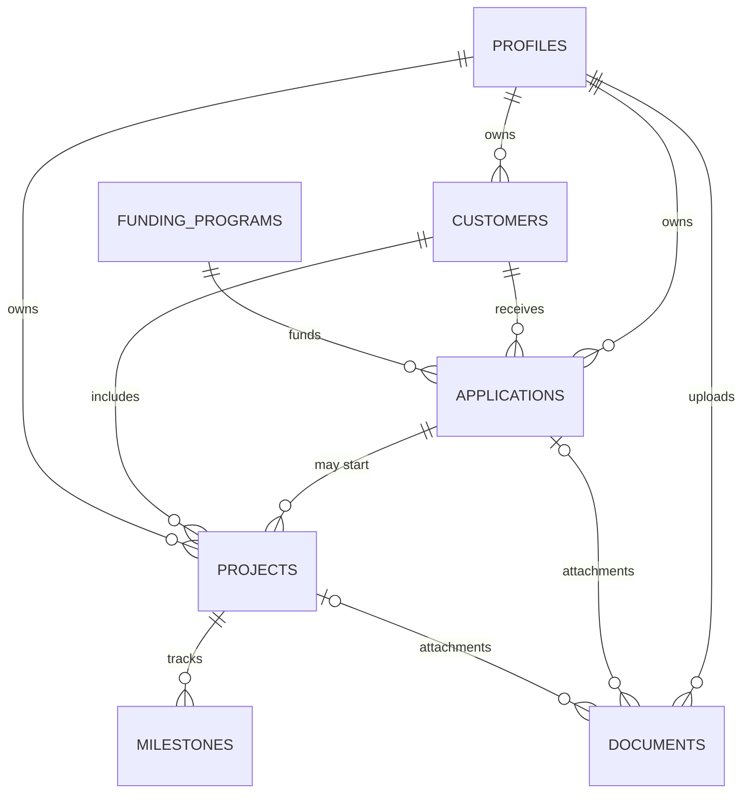
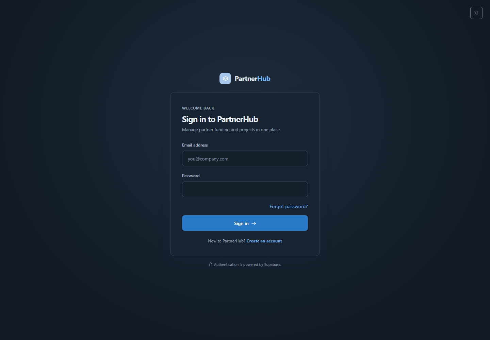

# PartnerHub

PartnerHub is a responsive, multi-page funding and project management application for organizing customers, funding applications, projects, milestones, and supporting documents.

**Live application:** [Open PartnerHub](https://partnerhubapp.netlify.app/src/pages/login.html)

## Features

- Supabase email/password registration, sign-in, password recovery, persistent sessions, and protected pages.
- Role-aware workspaces for administrators and regular users, with PostgreSQL Row-Level Security (RLS) enforcing access.
- Searchable funding applications, customers, projects, documents, and funding programs.
- Dashboard statistics, recent applications, upcoming deadlines, and a project calendar with links to related projects.
- Monthly or yearly funding trend analysis by currency. Trends compare requested amounts with currently approved allocations; they do not represent payments, cash spent, or profit.
- Private Supabase Storage for documents, with file type and 20 MiB size validation.
- Dark mode by default, with a persistent light-mode option.
- Responsive interface for desktop, tablet, and mobile.

## User roles

| Role | Access |
| --- | --- |
| Regular user | Manage their own customers, applications, and projects; manage milestones for their projects; view active funding programs; and access documents allowed by ownership policies. |
| Administrator | View and manage platform-wide customers, applications, and projects; manage users and account activation; manage funding programs; and administer documents and milestones. |

Roles and ownership are enforced in PostgreSQL policies and trusted database functions, not only in the interface. New profiles default to `user`; users cannot promote themselves.

## Technology

- HTML5, CSS3, and plain JavaScript ES modules
- Bootstrap 5 and Bootstrap Icons
- Vite and npm
- Supabase Auth, PostgreSQL, RLS, and private Storage
- Netlify for the hosted frontend
- GitHub Actions for local-database authorization tests

## Architecture

Each screen has its own HTML entry point. `src/js/main.js` handles page startup and authentication, shared layout and page templates live under `src/js/components/`, and Supabase operations are separated into `src/js/services/`. The Supabase client is initialized in `src/js/config/supabase.js`. Database schema, policies, functions, Storage setup, and status workflow are maintained as ordered SQL migrations in `supabase/migrations/`.

Vite's multi-page inputs are configured in `vite.config.js`. Data shown by the application comes from Supabase; the dashboard does not use hardcoded application metrics.

## Database schema

The database has seven application tables:

| Table | Purpose |
| --- | --- |
| `profiles` | User profile, role, and activation status linked to Supabase Auth. |
| `customers` | Customer/company details and assigned owner. |
| `funding_programs` | Funding descriptions, eligibility, limits, currency, and activation status. |
| `applications` | Funding requests, status, deadline, and requested/approved amounts. |
| `projects` | Projects linked to an application and customer, with owner, dates, status, and progress. |
| `milestones` | Dated work items belonging to a project. |
| `documents` | Metadata and private Storage path for an application or project file. |

UUID keys, foreign keys, checks, indexes, and RLS are defined in the migrations. A document must reference exactly one application or project. The actual file is stored in the private `partnerhub-documents` bucket, not in PostgreSQL.

Application statuses are `Draft`, `Submitted`, `Under Review`, `Approved`, and `Rejected`. Project and milestone statuses are `Not Started`, `In Progress`, `Completed`, and `On Hold`.



Each document is associated with **either** an application **or** a project, never both; this is enforced by a database constraint.

## Repository structure

```text
.
├── .github/
│   ├── copilot-instructions.md
│   └── workflows/database-tests.yml
├── public/assets/screenshots/
├── src/
│   ├── css/style.css
│   ├── js/
│   │   ├── components/
│   │   ├── config/supabase.js
│   │   ├── services/
│   │   └── main.js
│   └── pages/
├── supabase/
│   ├── migrations/
│   ├── seed.sql
│   └── tests/database/
├── .env.example
├── package.json
├── vite.config.js
└── README.md
```

## Screenshots

The screenshot below was captured from the running PartnerHub sign-in page using the default dark theme. It contains no account credentials.



## Environment and local development

Install dependencies and start the Vite development server:

```sh
npm install
```

Copy `.env.example` to `.env`, then set `VITE_SUPABASE_URL` and `VITE_SUPABASE_ANON_KEY` to your Supabase project URL and publishable/anon key. Never put a Supabase secret or service-role key in frontend environment variables. `.env` is ignored by Git.

Start the app:

```sh
npm run dev
```

Open the local URL printed by Vite. The root page redirects to sign-in. Screens are available at:

- `/src/pages/login.html`
- `/src/pages/register.html`
- `/src/pages/forgot-password.html`
- `/src/pages/reset-password.html`
- `/src/pages/dashboard.html`
- `/src/pages/applications.html`
- `/src/pages/customers.html`
- `/src/pages/projects.html`
- `/src/pages/documents.html`
- `/src/pages/admin.html`
- `/src/pages/programs.html`

The application uses Supabase Auth and the `profiles` table for sign-in, registration, password recovery, session persistence, profile loading, and role-aware routing. Registration does not accept a role. Supabase RLS and database functions remain the authority for data access.

## Authentication end-to-end testing

Browser end-to-end automation is not configured in this repository. `npm run test:db` runs pgTAP authorization tests, not browser registration, email, or session flows. Do not treat a successful build or pgTAP run as proof that the browser authentication flows passed.

The safest manual option is an isolated local Supabase stack with Docker and the local email catcher. The local configuration enables email confirmation and permits the Vite login callback. Do not point the local test app at the hosted project:

1. Start Docker, then run `npx supabase start` and `npx supabase db reset --local --no-seed` from the repository root. These commands reset only the local database.
2. In PowerShell, set the app to the local API and use only the publishable/anon key printed by `npx supabase status`, then start Vite:

   ```powershell
   $env:VITE_SUPABASE_URL = "http://127.0.0.1:54321"
   $env:VITE_SUPABASE_ANON_KEY = "<local publishable/anon key from supabase status>"
   npm run dev
   ```

   Do not use a production URL/key for this local run.
3. Open `/src/pages/register.html` and register a test-only identity such as `PartnerHub E2E User` with a unique email address. Local messages are captured by the email catcher at `http://127.0.0.1:54324`; they are not sent externally.
4. Open the confirmation email in the catcher. The link should return to `/src/pages/login.html` and establish a session. In the local Studio SQL Editor (`http://127.0.0.1:54323`), verify a `profiles` row exists for the Auth user with role `user` and `is_active = true`.
5. Sign out, verify the correct password signs in, and verify an incorrect password displays an error. Refresh a protected page while signed in; the session should remain active.
6. As the regular user, open `/src/pages/admin.html` directly; the app should redirect to the dashboard with an access-denied notice. Sign out and open a protected page; it should redirect to sign-in.
7. To test administration, create a second disposable user and use the documented first-admin bootstrap only in this isolated local database. Sign in as the admin; verify the user table and counts load, then change the other test user's role/status. The current administrator's own access controls should be disabled.
8. On the sign-in page, choose **Forgot password?**, request a reset for the test account, and use the email link to choose a new password. The reset callback is `/src/pages/reset-password.html`.

For hosted testing, add the app's exact callback URLs ending in `/src/pages/login.html` and `/src/pages/reset-password.html` to **Authentication > URL Configuration > Redirect URLs**. Use a test mailbox you control, never real employee/customer details, and do not commit test credentials.

## Supabase database setup

The ordered migrations in `supabase/migrations/` define the complete schema and access rules. For a new Supabase project:

1. Create a Supabase project and open its SQL Editor.
2. Apply each migration in timestamp order:
   - `20261031190000_partnerhub_backend.sql`
   - `20261031200139_admin_user_management.sql`
   - `20261101105119_application_status_workflow.sql`
   - `20261102160557_admin_submit_draft.sql`
3. Configure the Authentication site URL and redirect allowlist to include the app's `/src/pages/login.html` and `/src/pages/reset-password.html` URLs.
4. Configure the app's environment variables as described above.
5. Register an account. New profiles receive the `user` role by default. For a new project only, bootstrap the first administrator through the trusted SQL Editor as the project owner, replacing the placeholder with the registered user's profile UUID:

```sql
update public.profiles
set role = 'admin'
where id = 'AUTH_USER_UUID';
```

After the initial bootstrap, active administrators should use the guarded `public.set_profile_access` function to assign roles or deactivate accounts. Application clients cannot update profile roles directly. Do not use the bootstrap SQL to promote an account on an existing production project.

The optional `supabase/seed.sql` script creates fictional sample data for four funding programs, five customers, three applications, two projects, and three milestones. It requires an active profile first, creates no Auth users, and assigns the sample records to the oldest active profile. It uses fixed IDs and `ON CONFLICT DO NOTHING`; review ownership and existing records before running it. No shared demo login or password is published. Use the registration page for a regular account, and have an authorized administrator provision admin access.

The base migration enables RLS on all seven application tables, uses restrictive foreign-key deletion behavior, and creates the private `partnerhub-documents` bucket. Storage limits uploads to 20 MiB and supported document/image types. Files use paths shaped as `<uploader-uuid>/<applications|projects>/<record-uuid>/<document-uuid>/<filename>`. Related-record ownership and active-account checks are enforced in the database.

For an existing project, inspect its migration history and schema first. Apply only migrations that are not already present; do not blindly rerun the base migration against a database with existing PartnerHub tables or Storage objects. The hosted project is at [PartnerHub Supabase](https://supabase.com/dashboard/project/pxsapaipigauweaghzwg).

## Run database tests locally

The pgTAP suite at `supabase/tests/database/partnerhub_rls.test.sql` exercises row ownership, role protections, anonymous access, administrator permissions, and document Storage policies. It runs in a transaction and rolls back its fixtures. Do not run these test fixtures against the hosted project; the `test:db` script explicitly targets the local Supabase database.

On Windows, Docker Desktop requires WSL 2. If WSL is not installed, open PowerShell as an administrator, run `wsl --install --no-distribution`, and restart Windows. Then install and start Docker Desktop. From the repository root run:

```sh
npm install
npx supabase start
npm run test:db
```

The Supabase CLI is pinned in `devDependencies`. Local automatic seeding is disabled in `supabase/config.toml` because the demo seed requires a registered active profile; the RLS test creates its own temporary users and records.

GitHub Actions runs the same pgTAP suite on pushes to `main` and pull requests targeting `main`. The workflow uses a fresh local Supabase stack on `ubuntu-latest` and does not connect to the hosted project or require production secrets. View results in the repository's **Actions** tab under **Database tests**.

## Build and preview

```sh
npm run build
npm run preview
```

Vite builds each page as a separate HTML entry under `dist/`.

## Deployment

The production application is hosted on Netlify: [https://partnerhubapp.netlify.app](https://partnerhubapp.netlify.app). Open the [PartnerHub sign-in page](https://partnerhubapp.netlify.app/src/pages/login.html) to use it. Production deploys use the Vite build output in `dist/`; configure the Supabase URL and publishable/anon key as Netlify environment variables for the target deploy context.

## Application status workflow

Regular users can submit their own draft applications for review. Administrators can submit drafts on behalf of users, move submitted applications to **Under Review**, **Approved**, or **Rejected**, and approve or reject applications under review. The database enforces the allowed transitions.

The migrations that implement these transitions are listed in timestamp order in [Supabase database setup](#supabase-database-setup); ensure they have been applied to the target database before using the status controls.
